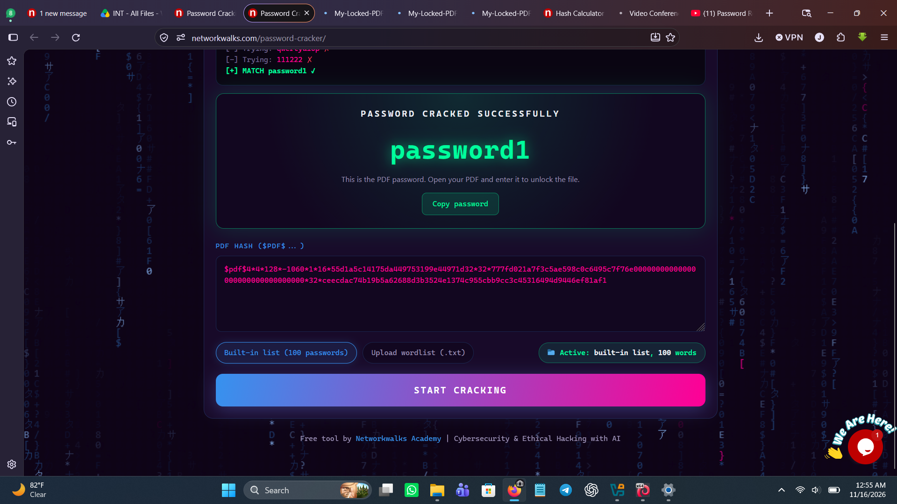
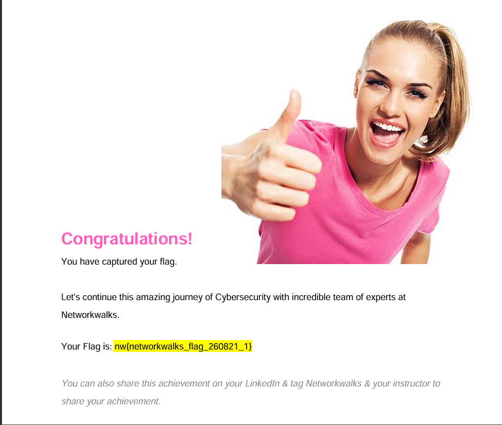
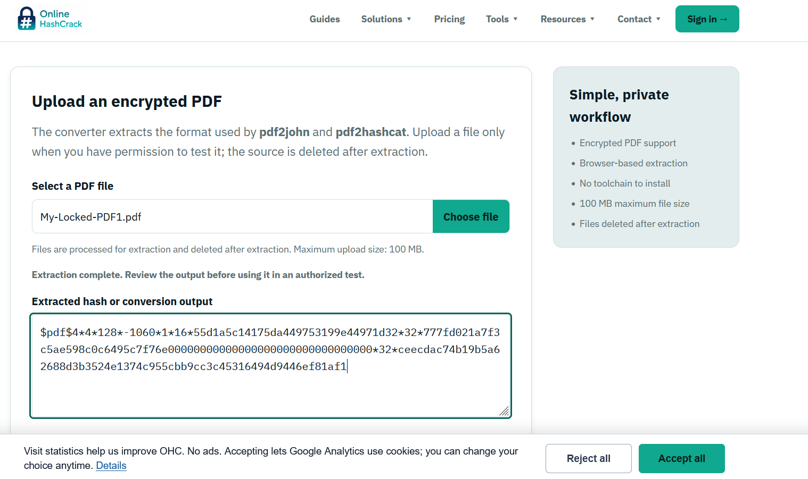
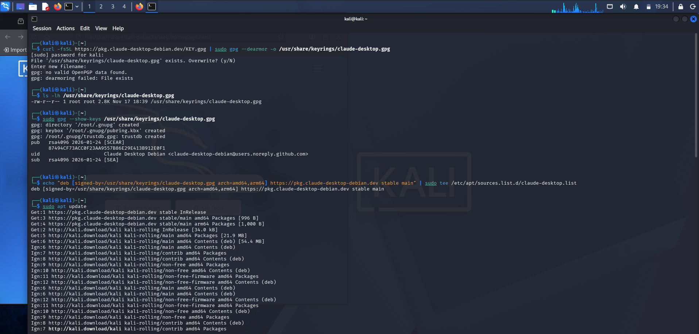

# NetworkWalks-Week3-Cybersecurity-Assessment
NETWORKWALKS ACADEMY - WEEK 3 CYBERSECURITY ASSESSMENT COMPLETED

### INFORMATION

| Field | Details |
|---|---|
| Student Name | John Dadzie |
| Training Institution | NetworkWalks Academy |
| Programme | Cybersecurity Training |
| Assessment | Week 3 Practical Assessment |
| Main Modules | W3-PM1 and W3-PM2 |
| Optional Practical | AI-Assisted Password Cracking Lab with Claude and HexStrike MCP |
| Operating System | Kali Linux |
| Repository | Week 3 Cybersecurity Assessment |

---

## 1. LIABILITY DISCLAIMER

This repository documents practical cybersecurity exercises completed as part of the NetworkWalks Academy cybersecurity training programme.

All activities documented in this report were conducted for educational purposes within the scope of the assigned training exercises and authorized lab environment.

The tools and techniques demonstrated are intended for ethical cybersecurity learning, password security awareness, and defensive security education.

No unauthorized access or testing outside the approved training scope is intended or endorsed.

---

## 2. INTRODUCTION

The Week 3 cybersecurity assessment focused on password security, password-cracking concepts, and the use of cybersecurity tools in a controlled learning environment.

The practical exercises provided an opportunity to understand how password security can be evaluated and how different tools can be used during authorized security assessments.

The assessment covered traditional password-cracking exercises using John the Ripper, practical work with NetworkWalks password-cracking tools, and an optional AI-assisted lab involving Claude Desktop and HexStrike MCP.

---

## 3. OBJECTIVES

The main objectives of the assessment were to:

- Understand password-cracking concepts and techniques.
- Gain practical experience with John the Ripper (JTR).
- Explore the NetworkWalks password-cracking tools.
- Understand the importance of password strength and security.
- Set up and explore Claude Desktop on Kali Linux.
- Gain exposure to AI-assisted cybersecurity workflows using HexStrike MCP.
- Document practical results and collect evidence of completed exercises.

---

## 4. TOOLS AND TECHNOLOGIES USED

| Tool / Technology | Purpose |
|---|---|
| Kali Linux | Cybersecurity testing and learning environment |
| John the Ripper (JTR) | Password security testing |
| NetworkWalks hash calculator & Password Cracker | Practical password-cracking exercises |
| Claude Desktop | AI-assisted learning and tool interaction |
| HexStrike MCP | MCP integration for AI-assisted cybersecurity workflows |
| Linux Terminal | Executing commands and managing the environment |

---

## 5. MODULES COMPLETED

The following practical modules were completed:

| Module | Description | Status |
|---|---|---|
| W3-PM1 | Password Cracking with John the Ripper | Completed |
| W3-PM2 | Password Cracking with NetworkWalks Tools | Completed |
| Optional Module 1 | AI-Assisted JTR Password Cracking Lab with Claude and HexStrike MCP | Completed |

---

## 6. ACTIVITIES PERFORMED

### 6.1 W3-PM1 – Password Cracking with John the Ripper

The first practical module focused on password security testing using John the Ripper.

Activities included working with the assigned password-cracking exercise, understanding the tool's role in password auditing, and completing the practical challenge.

The exercise resulted in successfully obtaining the assigned flag.

### 6.2 W3-PM2 – Password Cracking with NetworkWalks Tools

The second essential module involved using the NetworkWalks password-cracking tool.

The exercise provided practical exposure to the platform's password-cracking workflow and helped reinforce the concepts covered in the first module.

The assigned practical challenge was completed successfully, and the corresponding flag was obtained.

### 6.3 Optional Module – AI-Assisted JTR Lab with Claude and HexStrike MCP

This optional practical introduced AI-assisted cybersecurity workflows.

Activities included setting up the required environment, installing Claude Desktop on Kali Linux, and working through the instructor-provided HexStrike MCP lab instructions.

The practical provided exposure to integrating AI tools into cybersecurity learning and understanding how MCP-based workflows can support security-related tasks.

---

## 7. RESULTS AND OBSERVATIONS

The Week 3 assessment provided practical experience in password security testing and AI-assisted cybersecurity workflows.

Key results included:

- Successful completion of the John the Ripper practical.
- Successful completion of the NetworkWalks password-cracking practical.
- Successful retrieval of the assigned flags.
- Installation and setup work involving Claude Desktop on Kali Linux.
- Completion of the optional AI-assisted lab involving Claude and HexStrike MCP.

The exercises reinforced the importance of strong passwords, password security awareness, and responsible use of cybersecurity tools.

---

## 8. RISK ANALYSIS / IMPACT

Password weaknesses can expose systems and user accounts to unauthorized access.

The practical exercises demonstrated why organizations should:

- Enforce strong password policies.
- Avoid predictable and commonly used passwords.
- Use secure password storage practices.
- Implement multi-factor authentication.
- Conduct authorized password security assessments.
- Monitor and respond to suspicious authentication activity.

AI-assisted cybersecurity tools also require responsible use, proper authorization, and human oversight.

---

## 9. RECOMMENDATIONS

Based on the practical exercises, the following recommendations are made:

1. Organizations should enforce strong password policies.
2. Users should avoid reusing passwords across multiple accounts.
3. Multi-factor authentication should be enabled wherever possible.
4. Password security assessments should be conducted only with proper authorization.
5. Sensitive credentials and password data should be handled securely.
6. AI-assisted cybersecurity tools should be used responsibly and within approved environments.
7. Cybersecurity students should continue developing practical skills through controlled lab exercises.

---

## 10. CONCLUSION

The Week 3 cybersecurity assessment was a valuable practical learning experience.

Completing the essential modules provided hands-on exposure to password security testing using John the Ripper and NetworkWalks tools.

The optional Claude and HexStrike MCP practical also introduced AI-assisted cybersecurity workflows and expanded my understanding of how emerging technologies can support cybersecurity learning.

Overall, the assessment strengthened my understanding of password security, practical cybersecurity tools, and responsible security testing.

---

## 11. EVIDENCE COLLECTED

The following screenshots provide visual evidence of the practical activities and results achieved during the Week 3 assessment.

### Evidence 1

### Evidence 2

### Evidence 3

### Evidence 4

### Evidence 5

### Evidence 6

---

## 12. AUTHOR

**John Dadzie**

Cybersecurity Student | NetworkWalks Academy

- **LinkedIn:** [John Dadzie](https://www.linkedin.com/in/john-dadzie-a10404418/)
- **GitHub:** [GitHub Profile](https://github.com/johndhealpha-ctrl)

---
**NETWORKWALKS ACADEMY – WEEK 3 CYBERSECURITY ASSESSMENT**
